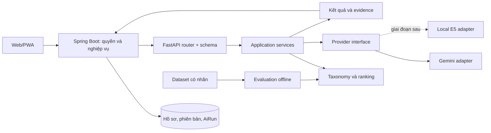

# Kiến trúc AI Service

Ngày cập nhật: 03/10/2026.

## 1. Ranh giới trách nhiệm

| Thành phần | Trách nhiệm | Dữ liệu sở hữu |
|---|---|---|
| Next.js/PWA | Rà soát kỹ năng, xem giải thích, sửa đề xuất, theo dõi trạng thái job | Trạng thái giao diện |
| Spring Boot | Kiểm tra quyền, consent, xác nhận, tài liệu nguồn, kỳ thực tập, ràng buộc và lưu phiên bản kết quả | Hồ sơ, CV, JD, minh chứng, AiRun, job queue |
| FastAPI | Trích xuất, chuẩn hóa, embedding, tính điểm và tạo đề xuất có nguồn | Config/model/taxonomy phục vụ inference; chưa ghi DB nghiệp vụ |
| Evaluation offline | Dataset, nhãn chuyên gia, baseline, metric, ablation và kết quả tái lập | Manifest và artifact nghiên cứu đã khử định danh |
| Provider | Chuyển đổi lời gọi model và lỗi về hợp đồng nội bộ | Không sở hữu hồ sơ nghiệp vụ |

Giữ FastAPI stateless trong giai đoạn này giúp không có hai nơi đồng thời cập nhật StudentSkill. Không thêm SQLAlchemy/PostgreSQL client vào service chỉ vì hệ thống chính dùng PostgreSQL.

## 2. Quy tắc đặt mã

- API nằm ở app/api/v1/routes. Không viết prompt, gọi SDK hay tính điểm trong router.
- Request/response nằm ở app/schemas; xác thực kích thước, số lượng, giá trị hữu hạn và provenance tại biên.
- app/services điều phối nghiệp vụ AI. ranking_service là hàm tính xác định; không dùng nhà cung cấp để sinh lý do cho một con số tùy ý.
- app/providers/base chứa Protocol; provider cụ thể không được import ngược router.
- app/core chứa config và lỗi dùng chung, không trở thành nơi gom nghiệp vụ.
- Prompt là tài nguyên có phiên bản; phải ghi phiên bản đó vào kết quả trích xuất.
- app/evaluation không được gọi trong request inference production. Sample router chỉ để kiểm tra metric thủ công.
- Khi làm JD review/journal/learning plan: thêm schema + service + prompt + tests tương ứng sau khi chốt hợp đồng. Chưa tạo module trống hoặc endpoint trả nội dung giả.
- Tách module nếu có trách nhiệm riêng thực sự; không cần repository layer cho một dịch vụ chưa sở hữu DB.

## 3. Luồng trích xuất

1. Backend xác thực chủ tài liệu/quyền xử lý; đọc text từ phiên bản CV/JD đã lưu.
2. Gửi text tối thiểu. API giữ nguyên whitespace để evidence offset tương ứng đầu vào.
3. Rule-based hoặc provider trả các đề cập kỹ năng. Gemini dùng schema có cấu trúc.
4. Chuẩn hóa sang ID nội bộ; kiểm tra quote thực sự tồn tại và có alias của kỹ năng.
5. Trả evidence, taxonomy_version, model, prompt_version, warnings, requires_confirmation.
6. Backend lưu bản nháp và nguồn; chỉ chuyển thành kỹ năng dùng để đối sánh khi sinh viên/doanh nghiệp xác nhận.

Ingestion nhận PDF/DOCX/TXT, trả checksum và số trang/khối; quote/offset tính trên văn bản trích xuất ghép nối, chưa có toạ độ hoặc mapping trang của từng quote. Backend liên kết tài liệu/lượt chạy/hash nguồn. Quy tắc phân loại mentioned/negated/learning dựa trên dấu hiệu từ ngữ, cần người dùng rà soát; không đo thành thạo.

## 4. Luồng đối sánh

1. Backend chọn vị trí đã duyệt/còn hiệu lực trong đúng kỳ theo quyền.
2. Đọc kỹ năng đã xác nhận; chuẩn bị vector hồ sơ và JD ngoài luồng request ranking.
3. Truyền một batch tối đa 200 vị trí; service không gọi cloud trong vòng lặp.
4. Chỉ dùng semantic khi hai vector hữu hạn, không rỗng, cùng model và dimension.
5. Thành phần thiếu bị loại; score_available=false nếu không còn thành phần sử dụng được.
6. Sắp xếp ổn định theo score, rồi ID; giữ nguyên khả năng ứng tuyển và bộ lọc thường.
7. Backend lưu recommendation_run và hiển thị metadata. Chưa có lưu run/cache trong FastAPI.

Công thức v2 là bước chuyển an toàn từ mã cũ: bỏ học lực mặc định, giữ tỷ lệ skill/semantic trước đó rồi chuẩn hóa. Công thức nghiên cứu có preference sẽ là phiên bản mới, chỉ bật khi đã có dữ liệu và benchmark.

## 5. Provider và cấu hình

Mặc định chạy rule-based/offline. Gemini là adapter tùy chọn dùng google-genai; import SDK khi cần, client được đóng sau lời gọi, timeout có giới hạn và SDK retry đặt một lần thử. Lỗi trả mã ngắn, không trả nội dung ngoại lệ chứa CV/key.

Giao diện EmbeddingProvider hiện có embed(text, task). Khi thêm E5/batch, mở rộng có test hợp đồng: model_name/revision, dimension, task/prefix, chunk policy. Không trộn vector của hai provider chỉ vì cùng số chiều. Mô hình được tải trong worker/startup có kiểm soát, không tải tự động từ Internet khi unit test/import router.

Hướng dẫn SDK đã đối chiếu với [Google Gen AI SDK](https://googleapis.github.io/python-genai/). Việc giữ dependency có thể thay thế tuân theo cơ chế [FastAPI dependencies](https://fastapi.tiangolo.com/tutorial/dependencies/).

## 6. Vận hành và bảo mật cần hoàn thiện trước pilot

- Backend giữ consent và quyền chia sẻ; không suy luận người dùng đồng ý chỉ vì đã upload CV.
- Chỉ truy cập FastAPI qua backend/private network; thêm service authentication và request size limit tại gateway.
- Rate limit theo người dùng ở backend; timeout tổng phải đồng bộ với client Java, hiện 20 giây cho lời gọi AI.
- Extraction dài/OCR chuyển thành job bất đồng bộ; retry có idempotency, giới hạn số lần, trạng thái lỗi và quyền retry.
- Health hiện chỉ kiểm tra process/config. Cần readiness/model smoke check riêng trước triển khai và theo dõi lỗi thực tế; không gọi model đắt tiền ở mọi liveness probe.
- Trace ID, model/prompt/taxonomy revision, token/cost và latency cần được lưu trong AiRun; không log raw CV.
- Backend xóa cache/index và vô hiệu hóa đề xuất khi nguồn bị xóa/rút quyền theo chính sách được duyệt.
- Trước dùng dữ liệu thật, kiểm tra retention của nhà cung cấp và các quy định trường đã xác nhận.

## 7. Kiểm chứng hiện có và giới hạn

Bộ test bao phủ hợp đồng payload Java, input sai, evidence, kỹ năng có dấu, dữ liệu thiếu, vector không tương thích, provider lỗi và công thức metric. Test Gemini dùng mock của SDK được cài, không xác minh model/account thực tế.

Các lớp compatibility ở app/routers giữ import router cũ; app/config chỉ re-export Settings. Singleton cũ như skill_service/embedding_service không còn là API nội bộ được hỗ trợ. Consumer HTTP Spring Boot giữ nguyên URL và các trường cốt lõi; ý nghĩa mode và khả năng semantic đã thay đổi như mô tả trong README.

Các thư mục kiến trúc chưa phải bằng chứng chất lượng mô hình. Chỉ có thể kết luận khi hoàn tất dataset, baseline và thử nghiệm ở kế hoạch triển khai.

## 8. Tích hợp ứng dụng hiện tại

AiWorkspaceService kiểm tra quyền và đọc CV; AiCvProcessingHandler lưu lượt chạy và minh chứng. AiMatchScoringHandler đọc yêu cầu theo batch và chỉ lấy kỹ năng đã xác nhận; metadata đến frontend. AiWorkspace hiển thị chức năng theo vai trò. Chế độ JD/checklist, nhật ký/extractive và learning/template được ghi rõ; đây chưa phải pipeline sinh nội dung dùng LLM. Xem IMPLEMENTATION_STATUS.md để phân biệt phần đã có code và tiêu chí nghiên cứu còn thiếu.
