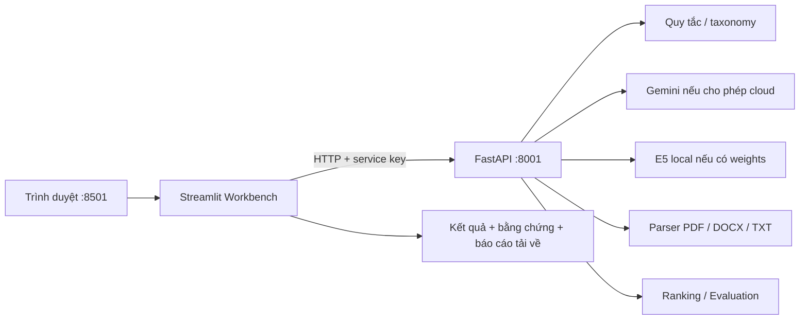
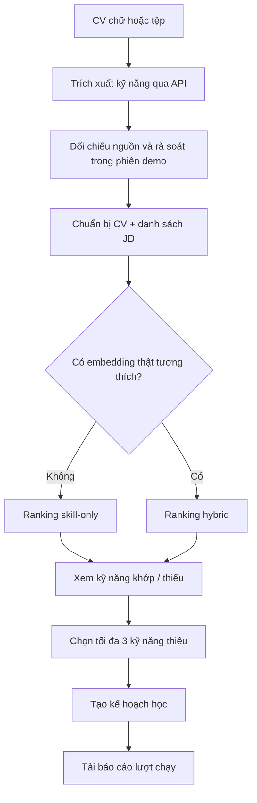

# Kế hoạch AI Workbench độc lập — InternLink

Ngày khảo sát: 17/10/2026 · Trạng thái: đề xuất, chưa triển khai giao diện.

## 1. Quyết định đề xuất

**Streamlit + HTTP client → FastAPI hiện có.** Chỉ chạy trong `ai-service`, không phụ thuộc Spring Boot, Next.js chính, PostgreSQL hoặc R2.



- Đây là giao diện gọi service thật; HTML mô phỏng trước đó chỉ làm tài liệu tham khảo bố cục.
- Key model nằm ở AI service; service key nằm ở tiến trình Streamlit, không đưa vào JavaScript/browser.
- Chọn Streamlit vì cùng Python, phù hợp upload, bảng chỉnh sửa, biểu đồ và lưu trạng thái phiên test. Gradio cũng phù hợp demo model; Vite/React thuận lợi nếu cần UI tùy biến sâu nhưng thêm một bộ công cụ FE.
- Spring AI là hướng tích hợp Java sau này, không phải một chế độ chạy trong Python Workbench.

## 2. Giao diện: 3 khu, không làm một trang quá dài

```text
┌ AI WORKBENCH ──────────────────────────────────────────────┐
│ Service: Online  | Extraction: rules/gemini | Embedding: … │
│ Model connectivity: chưa kiểm tra / gọi thật thành công    │
├ [1. CV → Đối sánh] [2. Hỗ trợ AI] [3. Kiểm thử & đánh giá] ┤
│ ĐẦU VÀO                      │ KẾT QUẢ                    │
│ Chọn mẫu / dán chữ / tải CV   │ Kỹ năng + trích dẫn         │
│ Chọn chế độ được hỗ trợ       │ Phủ định / đang học        │
│ □ Đồng ý gửi cloud           │ Quyết định rà soát          │
│ [Chạy bước này] [Chạy luồng]  │ Điểm + lý do + cảnh báo     │
├ Nguồn → Trích xuất → Rà soát → Đối sánh → Kế hoạch học     ┤
│ Thời gian | HTTP status | Model | Mode | JSON [mở khi cần] │
└ [Tải báo cáo JSON/CSV] [Xóa phiên thử]                      ┘
```

**Khu 1 — CV → Đối sánh:** văn bản/tệp, bảng kỹ năng cạnh nguồn, chọn kỹ năng đã rà soát, nhập 3–5 JD mẫu, xem xếp hạng và kỹ năng thiếu; chuyển kỹ năng thiếu sang kế hoạch học.

**Khu 2 — Hỗ trợ AI:** bốn mục nhỏ: rà soát JD, nhật ký, kế hoạch học, phân tích câu tìm kiếm. Có mẫu điền sẵn, form tự nhập, kết quả dễ đọc và JSON mở rộng.

**Khu 3 — Kiểm thử & đánh giá:** chạy từng ca hoặc bộ ca; so quy tắc/Gemini trên cùng đầu vào; xem kết quả thật, fallback, lỗi và báo cáo đánh giá có nhãn chuẩn.

Mọi màn hình có trạng thái chưa chạy, đang chạy, thành công, kết quả rỗng, fallback và thất bại. Không dùng điểm ngẫu nhiên hoặc thời gian giả.

## 3. API có thể test ngay

Các đường dẫn dưới đây đã có trong code; “có code” chưa xác nhận tài khoản model/weights đang hoạt động.

| Chức năng | Endpoint | Cần hiển thị đúng |
|---|---|---|
| Trạng thái | `GET /health/live` | Service sống ≠ Gemini đã kết nối; hiện `provider_connectivity=not_probed` |
| Taxonomy | `GET /api/v1/skills/taxonomy` | Taxonomy nội bộ; mapping ESCO còn pending |
| Chuẩn hóa kỹ năng | `POST /api/v1/skills/normalize` | Kỹ năng khớp và unmatched |
| CV/JD dạng chữ | `POST /api/v1/skills/extract` | `source_type`, mode thực tế, assertion, quote và offset |
| CV dạng tệp | `POST /api/v1/skills/extract-document` | PDF/DOCX/TXT; source hash; lỗi đọc/OCR |
| Embedding | `POST /api/v1/matching/embedding` | Vector thật, model, dimension và task |
| Xếp hạng | `POST /api/v1/matching/rank-jobs` | skill-only/hybrid/semantic-only/thiếu dữ liệu |
| Rà soát JD | `POST /api/v1/assistance/job-review` | Hiện là checklist quy tắc |
| Nhật ký | `POST /api/v1/assistance/journal-summary` | Trích claim + nguồn, không phải tóm tắt LLM |
| Kế hoạch học | `POST /api/v1/assistance/learning-plan` | Mẫu quy tắc, 1–3 kỹ năng, tổng giờ đúng ngân sách |
| Câu tìm kiếm | `POST /api/v1/assistance/parse-query` | Parser quy tắc; trả bộ lọc, chưa truy vấn kho việc làm |

## 4. Luồng demo thực tế



- **Chạy từng bước:** thích hợp trình bày với giảng viên; mỗi bước xem request/response.
- **Chạy luồng:** tự chạy các bước kỹ thuật, nhưng dừng ở rà soát để người dùng quyết định; không tự xác nhận kỹ năng.
- Kỹ năng `negated`/`learning` không tự đưa vào danh sách đã xác nhận để ranking. Có thể sửa khai báo trong demo nhưng phải lưu lý do và nhãn thủ công.
- JD trích xuất bằng `source_type=jd`; người dùng rà lại nhóm mandatory/optional, xử lý nhóm unspecified trước khi rank.
- Hybrid: tạo embedding CV bằng `retrieval_query`, JD bằng `retrieval_document`, giữ cùng model/revision/dimension. `rank-jobs` hiện không tự sinh vector.
- Công thức hiện có: kỹ năng bắt buộc 80% + ưu tiên 20% khi đủ hai nhóm; hybrid = `(0.55 × skill + 0.35 × semantic) / 0.90`. UI hiển thị kết quả service, không chép lại thuật toán.
- Nguồn, JD hoặc model đổi → đánh dấu kết quả phụ thuộc là cũ, xóa xác nhận/cache tương ứng và yêu cầu chạy lại.

## 5. Khoảng trống cần xử lý để demo trung thực

| Hiện trạng | Quyết định cho demo |
|---|---|
| Extraction Gemini lỗi đã fallback về rules với warning | Hiện “Yêu cầu Gemini → thực tế rules”, giữ warning; không gọi đó là Gemini thành công |
| Embedding lỗi/disabled trả 503 | Hiện lỗi thật; nếu người dùng chọn tiếp tục skill-only thì chạy lượt riêng, không tạo vector giả |
| Tệp trả kỹ năng nhưng không trả toàn bộ text nguồn | Thêm endpoint preview chỉ trong demo, dùng lại parser; hoặc bước parse riêng trả text/blocks, rồi extraction; cùng bytes/hash |
| PDF scan chưa OCR | MVP test được nhánh `ocr_required`; muốn OCR thành công cần triển khai parser/OCR riêng ở giai đoạn 2 |
| `page_count` DOCX hiện là số phần nội bộ, không phải phân trang Word | Gắn nhãn đoạn/tài liệu; không hiển thị số trang DOCX như PDF |
| Chưa có schema toàn hồ sơ, duyệt lưu lâu dài, DOCX export | MVP chỉ review trong phiên + JSON/CSV; không mô tả là hoàn thành workflow hồ sơ 6 bước |
| ClamAV/R2/quyền nghiệp vụ đang ở backend chính | MVP dùng fixture biết nguồn gốc, lưu tạm cục bộ, nhãn “chưa có quét mã độc”; nhận tệp không tin cậy cần cổng scan riêng trước parser |
| Embedding request chưa có `allow_cloud` | Bổ sung cờ mặc định false và kiểm tra phía service trước khi cho demo gửi cloud embedding; dùng local E5 nếu không cho cloud |
| Provider được cấu hình lúc khởi động | UI đọc capabilities; không sửa `.env` hoặc đổi provider toàn cục giữa các phiên. Đổi embedding bằng restart profile hoặc instance riêng |
| CORS hiện chưa cho header service key | Streamlit gọi HTTP phía server nên không cần mở CORS hoặc đưa key vào browser |

Endpoint preview/evaluate và fault injection được bật riêng bằng app factory/profile demo, không tự xuất hiện ở service thông thường. Không thêm endpoint bỏ qua service authentication.

## 6. Chế độ thật và chế độ thử lỗi

| Chế độ | Cách chạy | Nhãn bắt buộc |
|---|---|---|
| Rules | `allow_cloud=false`, dùng logic hiện tại | `RULE_BASED` |
| Gemini | Server cấu hình Gemini + người dùng cho cloud | Model thực, mode trả về, fallback nếu có |
| Local E5 | Có weights và revision trên máy | Local model/revision, không tự tải weights |
| Fault test | Instance/app factory riêng, provider giả được tiêm để timeout/lỗi quote/JSON | `FAULT_INJECTION`, không tính vào chất lượng model |

Health chỉ đọc cấu hình. Nút “Thử kết nối model” gửi một mẫu ngắn được ghi rõ và có thể phát sinh phí; không tự probe khi mở trang.

Session state giữ input/output riêng từng phiên; dùng form + nút submit để không gọi lại model khi chỉnh bộ lọc hoặc chuyển trang. Cache chỉ theo content hash + model/revision/task/dimension, không chia sẻ nội dung CV giữa người dùng.

## 7. Bộ ca test cần có

| Ca | Kết quả mong đợi |
|---|---|
| “Dùng Java. Chưa biết Docker. Đang học Kubernetes.” | Ba trạng thái tách rõ; người dùng chọn kỹ năng đủ điều kiện |
| JavaScript, Java, C++, C# | Không nhận nhầm tên; kết quả sai được ghi FAIL để sửa service |
| “Bắt buộc Java. Ưu tiên Docker.” | JD phân nhóm đúng |
| PDF chữ / DOCX / TXT | Trích xuất thật, hash đúng; quote khớp nguồn parser |
| PDF scan / mã hóa / tệp hỏng / quá lớn | Mã lỗi thật, lời giải thích và cách xử lý |
| Không cho cloud | Provider cloud không được gọi, gồm cả embedding |
| Gemini timeout / JSON hỏng / quote bịa | Test provider có nhãn; kiểm tra fallback hoặc loại quote + warning |
| Vector khác model/dimension | Bỏ semantic, hiện warning; không vẫn ghi hybrid |
| Thiếu kỹ năng và vector | `insufficient_data`, không hiển thị như độ phù hợp 0% đã đo |
| Service tắt / sai key | Hiện kết nối lỗi / 401, không sinh kết quả thành công |
| Nhật ký, kế hoạch học, câu tìm kiếm | Giữ nguồn; đúng ngân sách giờ; bộ lọc đúng đầu vào |
| Chạy lại / đổi nguồn / chuyển trang | Không gọi model ngoài ý muốn; kết quả cũ được đánh dấu |

**Đánh giá:** dùng `app/evaluation/runner.py` qua adapter demo, nhận dataset có split/provenance/nhãn; ít nhất 5 JD/query, nhãn đầy đủ. Không dùng `/benchmarks/run-sample-evaluation` làm số liệu luận văn vì route đó có điểm dựng sẵn.

Đo P@5, Recall@5, MRR, nDCG@5 trên tập query chung. Không có vector thì không báo Dense/Hybrid. Đánh giá extraction cần bổ sung nhãn chuẩn và bộ chấm riêng; hiện chưa có UI/bộ chấm đầy đủ cho việc này.

## 8. Cấu trúc triển khai đề xuất

```text
ai-service/
  demo/                       # UI và điều phối các bước test
    app.py                    # Khung trang + điều hướng
    pages/                    # pipeline, assistance, evaluation
    components/               # source viewer, result table, status, review
    client.py                 # HTTP, auth header, timeout, chuẩn hóa lỗi
    state.py                  # State phiên, đánh dấu kết quả cũ
    workflows.py              # Gọi chuỗi endpoint, không chứa thuật toán AI
    reports.py                # JSON/CSV, che thông tin nhạy cảm mặc định
    fixtures/                 # CV/JD/nhật ký biết nguồn gốc
  app/demo/                   # API preview/evaluate và factory thử lỗi, opt-in
  tests/demo/                 # Client, state, workflow, UI
  requirements-demo.txt       # Streamlit + HTTP client, tách dependency
```

Mỗi file một trách nhiệm, mục tiêu 150–200 dòng, không vượt 350 dòng. Không import service nghiệp vụ vào UI để gọi trực tiếp; mọi tác vụ AI đi qua HTTP. Adapter evaluation phía API có thể gọi lại module đánh giá hiện có.

Hai lệnh khởi động dự kiến (chỉ dùng sau khi đã triển khai):

```text
python -m uvicorn app.main:app --host 127.0.0.1 --port 8001
python -m streamlit run demo/app.py --server.address 127.0.0.1 --server.port 8501
```

Factory demo riêng sẽ dùng entrypoint tương ứng cho preview/evaluate/fault tests. Khởi động thông thường không tải chức năng tiêm lỗi. Giữ service key ở môi trường server; không bắt buộc tắt xác thực để chạy demo.

## 9. Thứ tự thực hiện và tiêu chí hoàn thành

| Mốc | Công việc | Hoàn thành khi |
|---|---|---|
| M1 · Nền + extraction | UI 3 khu, client, health, fixtures, taxonomy, text/file extraction, source preview | Bấm chạy nhận response thật; nhận diện fallback; thấy nguồn cạnh kết quả |
| M2 · Luồng liên hoàn | Review phiên, JD, embedding, rank, kỹ năng thiếu → kế hoạch học | Chạy từ CV đến ranking không cần BE/FE chính; đổi nguồn làm kết quả cũ mất hiệu lực |
| M3 · Bao phủ chức năng | Checklist JD, nhật ký, query parser, lỗi/consent, báo cáo | Mọi endpoint trong mục 3 có form và ca test; không giấu lỗi |
| M4 · Đánh giá + bàn giao | Adapter runner, so sánh, AppTest + integration, README/launcher | Báo cáo có model/mode/hash/cảnh báo; demo chạy từ hướng dẫn; rõ kiểm thử mock và gọi model thật |
| Giai đoạn 2 · Tùy nhu cầu | OCR, toàn hồ sơ, scan độc lập, DOCX local, lịch sử bền vững | Sáu bước hồ sơ chạy thật trong môi trường demo, vẫn không phụ thuộc BE/FE chính |

Ước lượng ban đầu M1–M4: 5–8 ngày làm việc, phụ thuộc lỗi service và môi trường model. OCR/toàn hồ sơ/DOCX cần ước lượng lại sau pilot, không gộp vào cam kết MVP.

AppTest kiểm tra UI/state với HTTP client thay thế; integration gọi FastAPI qua TestClient và ít nhất một lượt localhost HTTP thật. Upload/preview kiểm tra thủ công nếu widget chưa được AppTest hỗ trợ đầy đủ ở bản đã khóa. Test tự động không gọi cloud; chạy Gemini thật là checklist riêng, ghi kết quả/thời gian/ngày/model và có consent.

MVP đạt khi chạy được offline trước, toàn bộ chức năng đang có test được, và các phần chưa triển khai hiện rõ “chưa hỗ trợ”. Không bắt buộc PostgreSQL, không lưu CV lâu dài mặc định; báo cáo không chứa key, xuất nội dung nguồn chỉ khi chủ động chọn.

## 10. Căn cứ nghiên cứu

- Code: `app/main.py`, `app/api/v1/routes/*`, `app/schemas/*`, `app/services/skill_service.py`, `app/services/ranking_service.py`, `app/providers/*`, `app/ingestion/documents.py`, `app/evaluation/runner.py`, `tests/test_workflows.py`.
- [Streamlit multipage](https://docs.streamlit.io/develop/concepts/multipage-apps): chia màn hình theo tác vụ.
- [Streamlit forms](https://docs.streamlit.io/develop/api-reference/execution-flow/st.form): chỉ gửi nhóm input khi submit.
- [Session State](https://docs.streamlit.io/develop/api-reference/caching-and-state/st.session_state): trạng thái phiên và chuyển trang; không coi là lưu trữ bền vững.
- [File uploader](https://docs.streamlit.io/develop/api-reference/widgets/st.file_uploader), [data editor](https://docs.streamlit.io/develop/api-reference/data/st.data_editor): upload và rà soát bảng.
- [AppTest](https://docs.streamlit.io/develop/api-reference/app-testing/st.testing.v1.apptest): kiểm thử giao diện; kiểm tra giới hạn theo phiên bản khóa.
- [Gradio API](https://www.gradio.app/docs): phương án đối chiếu khi chọn công cụ UI.

Chưa thay đổi runtime của AI service, chưa gọi model thật, chưa triển khai giao diện trong lượt lập kế hoạch này. Đã thử chạy pytest trong `.venv` với rules/embedding-disabled nhưng tiến trình không trả output và đã dừng; chưa xác nhận bộ test hiện tại đạt. M1 cần xác minh môi trường và chạy lại baseline trước khi sửa service.
